# Codyssey Mission 1 — 개발자용 작업실 꾸미기

미션1. 개인용작업환경만들기

## 1. 미션 개요

Windows 환경에서 Git, VS Code, Docker를 설치하고 Linux 컨테이너, Dockerfile, 포트 매핑, 바인드 마운트, Docker 볼륨, Git 저장소를 실습했다.

## 2. 실행 환경

- OS: Windows
- Shell: PowerShell
- Docker: 29.9.2
- Docker Desktop: 4.98.0
- WSL: WSL 2
- Git 사용자: Codyssey Student

## 3. 수행 체크리스트

- [x] Windows 환경 확인
- [x] Git 설치 확인
- [x] VS Code 설치 확인
- [x] Docker 및 WSL 설치
- [x] Docker 엔진 점검
- [x] hello-world 실행
- [x] Ubuntu 컨테이너 실행
- [x] Linux 파일 및 디렉터리 권한 실습
- [x] Dockerfile 작성
- [x] 커스텀 NGINX 이미지 빌드
- [x] 포트 매핑 및 웹 접속
- [x] 바인드 마운트 변경 반영
- [x] Docker 볼륨 영속성 검증
- [x] Git 저장소 초기화 및 설정

## 4. Docker 기본 점검

```powershell
docker --version
docker info
docker run hello-world
docker images
docker ps -a
```

점검 결과:

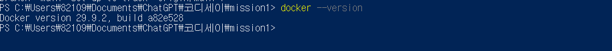

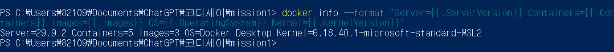

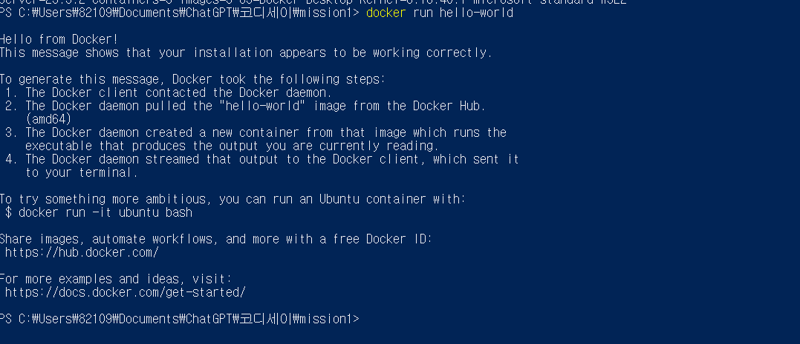

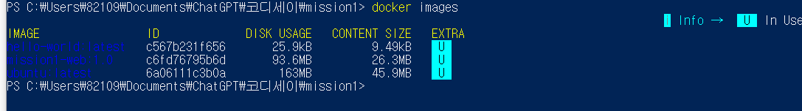

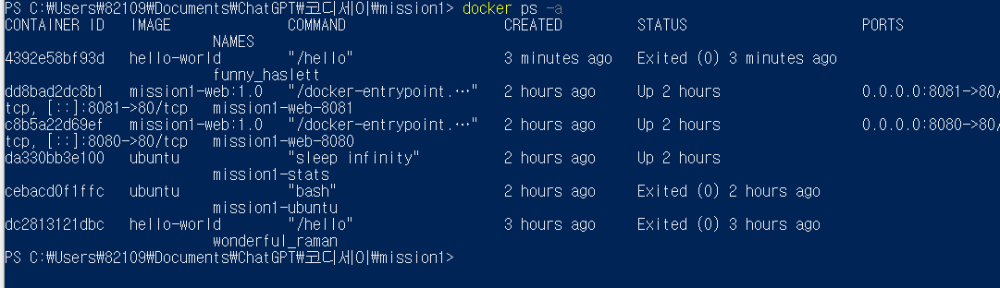

## 5. 커스텀 웹 서버

베이스 이미지는 `nginx:alpine`을 사용했다. 직접 작성한 `index.html`을 NGINX 웹 루트에 복사했다.

```dockerfile
FROM nginx:alpine
COPY index.html /usr/share/nginx/html/index.html
```

### 빌드 및 실행

```powershell
docker build -t mission1-web:1.0 .
docker run -d --name mission1-web-8080 -p 8080:80 mission1-web:1.0
docker run -d --name mission1-web-8081 -p 8081:80 mission1-web:1.0
```

### 접속 검증

```powershell
curl.exe http://localhost:8080
curl.exe http://localhost:8081
```

브라우저 접속 주소:

- http://localhost:8080
- http://localhost:8081

접속 결과에는 다음 문구가 표시된다.

```text
Docker Web Server Test Success
```

접속 증거:

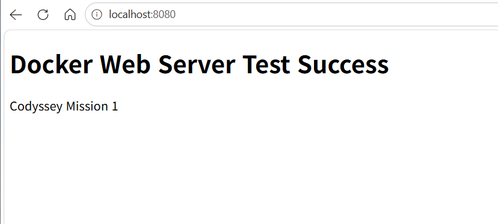

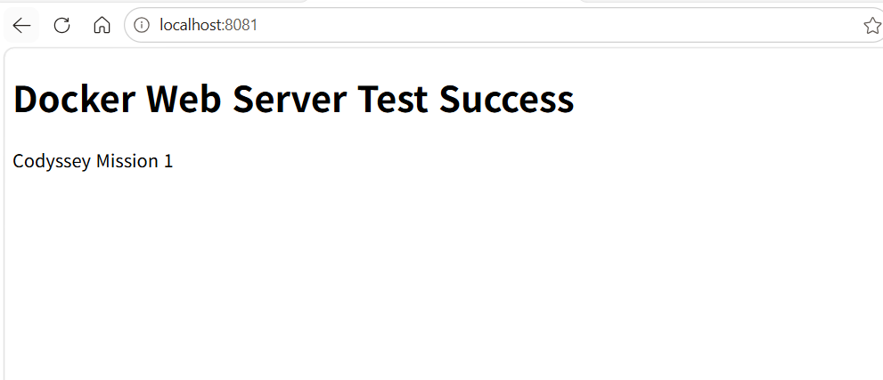

## 6. 바인드 마운트

호스트의 `bind-data` 폴더를 컨테이너의 `/data`에 연결했다.

```powershell
docker run --rm -v "C:\Users\82109\Documents\ChatGPT\코디세이\mission1\bind-data:/data" ubuntu cat /data/message.txt
```

호스트 파일을 수정한 뒤 컨테이너에서 변경된 내용을 확인하여 바인드 마운트 반영을 검증했다.

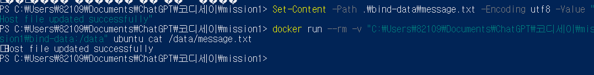

## 7. Docker 볼륨 영속성

`mission1-data` 볼륨에 데이터를 저장한 뒤 컨테이너를 삭제하고 새 컨테이너에 같은 볼륨을 연결했다.

```powershell
docker volume create mission1-data
docker run -d --name mission1-volume-1 -v mission1-data:/data ubuntu sleep infinity
docker exec mission1-volume-1 sh -c "echo '볼륨 영속성 테스트 데이터' > /data/keep.txt"
docker rm -f mission1-volume-1
docker run --rm --name mission1-volume-2 -v mission1-data:/data ubuntu cat /data/keep.txt
```

컨테이너 삭제 후에도 데이터가 유지되는 것을 확인했다.

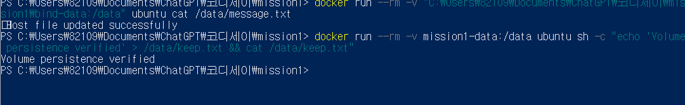

## 8. Git 설정

```powershell
git config --local --list
git branch -M main
git status
```

## 9. 증거 자료

모든 캡처는 [`screenshots`](screenshots/) 폴더에 저장했다.

### Linux 권한 실습

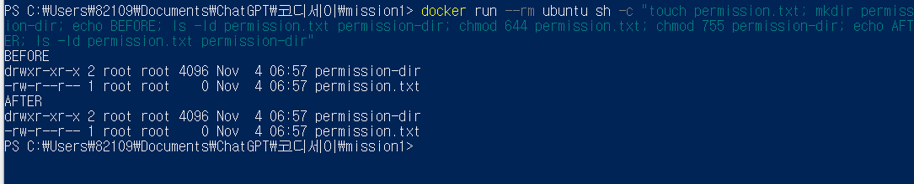

### GitHub 저장소 반영 결과

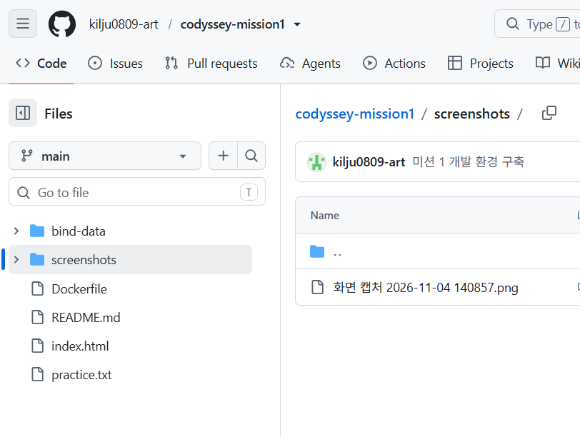

## 10. 트러블슈팅

### 문제 1: WSL 버전이 너무 오래됨

- 문제: Docker Desktop에서 `WSL needs updating` 메시지가 표시됨
- 원인 가설: 설치된 WSL 버전이 Docker Desktop 요구사항보다 낮음
- 확인: Docker 설치 화면의 오류 메시지 확인
- 해결:

```powershell
wsl --update
```

- 결과: WSL 업데이트 후 컴퓨터를 재시작하고 Docker Desktop이 정상 실행됨

### 문제 2: 바인드 마운트 폴더를 찾을 수 없음

- 문제: `bind-data\message.txt` 생성 시 경로를 찾을 수 없다는 오류 발생
- 원인 가설: `bind-data` 폴더가 실제로 생성되지 않음
- 해결:

```powershell
New-Item -ItemType Directory -Path .\bind-data -Force
```

- 결과: 폴더를 다시 생성한 뒤 파일 생성과 바인드 마운트 검증에 성공함
